# DinerAI operations data model

The data behind forecasting, rotas, menu engineering, finance and deals
(step 24). Schema only: tables, migrations, types, read/write helpers and tests.
No screens, WhatsApp flows, data generator or models yet.

- SQL: `supabase/030_ops_foundation.sql` to `supabase/037_ops_menu_guard.sql`, plus `038_ops_data_gaps.sql` (gaps found by the synthetic data generator: sunshine, the trading day cut-off, a per-restaurant clear-out, channel fees); rollback `supabase/rollback/ops_rollback.sql`.
- Code: `src/lib/ops/` (types, helpers per group, plain-code rules).
- Tests: `tests/ops-schema.test.ts` (the real SQL in PGlite), `tests/ops-helpers.test.ts`, `tests/ops-menu-app.test.ts`.

## Rules every table follows

- **History, never overwrite.** Two patterns:
  - *One value over time* (dish price, ingredient price, pay rate, target, recipe): rows are never changed. Each has `effective_from` (the London day it applies from) and `recorded_at` (when we learned it). The value on a day is the row with the latest `effective_from` on or before it; a correction for the same day is a newer row and wins. Code: `valueOn(rows, day, { knownAt })` in `ops/history.ts`; SQL: `dish_price_on`, `ingredient_price_on`, `pay_rate_on`, `target_on` (each takes an optional "known at" moment).
  - *A set of items with spans* (availability, cover rules, fixed costs): `effective_from` and `effective_to` (the first day it no longer applies). Code: `activeOn(rows, day)`.
- **Outputs are append-only.** Forecasts, suggested rotas, menu analysis, finance snapshots, deal outcomes and weather forecasts: a new run adds rows, readers take the latest `issued_at`.
- **Every input row says where it came from**: `source` is one of `photo`, `export`, `manual`, `owner_message`, `assumed`, `feed`, `synthetic`, `model`, `migrated` (the `ops_source` domain). Rows a person should check have `confirmed_at` and `confirmed_by`.
- **Money is whole pence** (`int`/`bigint`). The older sales tables (`sales_days`, `sales_hours`, `sales_items`, `z_reports`) keep pounds; the analytics views give pence (`ops_pence`). Helpers: `ops/money.ts` (`toPence` works from the text, so float errors can't creep in).
- **Quantities are in the ingredient's unit**: g, ml or each. `ops/units.ts` turns "5kg", "2 x 1L", "case of 24" into them.
- **Times**: timestamps in UTC; business days and hours in Europe/London. New hourly tables are keyed by the UTC start of the hour, so the October hour that happens twice stays two rows. The till's own hours (`sales_hours`) stay as London hours: on the last Sunday of October hour 01 covers two real hours, and `analytics.sales_hourly` says so (`minutes` = 120; 0 for the March hour that doesn't exist). Code: `ops/hours.ts`; SQL: `london_day`, `london_hour`, `london_hour_start`, `london_hour_minutes`.
- **Every table carries `restaurant_id`**, except the shared `venues` and `football_fixtures` (and shared rows of `local_calendar`, where it's empty). Child rows reference their parent with `(id, restaurant_id)`, so a row can't point at another restaurant's parent.

## Diagram

New tables in plain boxes; existing tables that changed are marked "(changed)" in the notes below. Shared tables have no `restaurant_id`.

```mermaid
erDiagram
  restaurants ||--o{ menu_sections : has
  menu_sections ||--o{ dishes : holds
  dishes ||--o{ dish_prices : "price history"
  dishes ||--o{ dish_renames : "name history"
  dishes ||--o{ recipe_versions : "recipe history"
  recipe_versions ||--o{ recipe_lines : lines
  ingredients ||--o{ recipe_lines : "used in"
  ingredients ||--o{ ingredient_prices : "price history"
  dishes ||--o{ till_item_matches : "till names"
  till_item_matches ||..o{ sales_items : "by name key (view)"
  restaurants ||--o{ sales_days : "(changed) covers"
  restaurants ||--o{ sales_hours : "(changed) covers"
  restaurants ||--o{ sales_channel_splits : channels
  staff_numbers ||--o| staff : "also sends till reports"
  staff ||--o{ staff_pay_rates : "pay history"
  staff ||--o{ staff_availability : "weekly pattern"
  staff ||--o{ staff_time_off : exceptions
  restaurants ||--o{ cover_rules : "cover rules"
  rota_weeks ||--o{ rota_shifts : planned
  staff ||--o{ rota_shifts : works
  rota_shifts ||--o{ shift_actuals : actual
  staff ||--o{ shift_actuals : worked
  suppliers ||--o{ invoices : sends
  invoices ||--o{ invoice_lines : lines
  ingredients ||--o{ invoice_lines : "matched to"
  invoice_lines ||--o| ingredient_prices : "price from"
  restaurants ||--o{ fixed_costs : pays
  restaurants ||--o{ targets : aims
  campaigns ||--o{ deal_outcomes : "(changed: unique id+restaurant)"
  restaurant_events ||--o{ deal_outcomes : "in-store promotion"
  model_runs ||--o{ forecasts : issues
  model_runs ||--o{ suggested_rotas : suggests
  rota_weeks ||--o{ suggested_rotas : for
  suggested_rotas ||--o{ suggested_rota_shifts : shifts
  model_runs ||--o{ menu_analysis : analyses
  dishes ||--o{ menu_analysis : about
  model_runs ||--o{ finance_snapshots : computes
  model_runs ||--o{ deal_outcomes : measures
  jobs ||--o{ model_runs : "queue job"
  restaurants ||--o{ weather_days : "(existing) daily"
  restaurants ||--o{ weather_hours : hourly
  restaurants ||--o{ weather_forecasts : "as issued"
  venues ||--o{ local_calendar : "(changed) at"
  local_calendar ||--o| football_fixtures : detail
  local_calendar ||--o{ calendar_relevance : "per restaurant"
  restaurants ||--o{ calendar_relevance : marks
  restaurants ||--o{ restaurant_teams : follows
  restaurants ||--o{ prayer_times : "per day"
  restaurants ||--o{ restaurant_events : "own events"
  campaigns ||--o{ restaurant_events : promotion
```

## Tables

### 1. Menu and recipes (`031_ops_menu.sql`)

- **menu_sections**: the menu's sections in order. `active_to` = off the menu from that day.
- **dishes**: the single source of truth for the menu: section, name, description, allergens (and whether the owner confirmed them), position, `active_from`/`active_to`. A dish keeps its id when renamed, re-priced, moved, or taken off and put back. `json_keys`/`extra` only exist so the menu copy is exactly the old JSON (a missing key stays missing, unknown keys survive); they can go once every reader reads dishes.
- **dish_prices**: price history (pence; empty = the menu gave none).
- **dish_renames**: every name change of a dish.
- **ingredients**: name, standard unit (g, ml, each), category.
- **recipe_versions** / **recipe_lines**: a dish's recipe from a day: ingredient, quantity in its unit, waste %, portions.
- **till_item_matches**: a till item name ("Chkn Tikka") to a dish, with confidence, method (exact, fuzzy, ai, owner) and the owner's confirmation. `till_key` is the name lower-cased with single spaces; `sales_items` join on the same key (an index on `ops_name_key(item)`), so item sales link to dishes without a column on every sales line. `is_dish = false` for lines that aren't dishes ("Service charge").
- **menu_json_backup**: every restaurant's menu as it was before the move (one row each, never overwritten).

**The menu move.** `restaurants.menu` stays as a copy made from the dishes by `menu_json()`, and every existing reader (customer-safe menu, allergens, prompts, `prices.ts`, `offers.ts`, the checks, the agents) reads it unchanged. The one way to change the menu is `save_menu()` (`saveMenu` in `ops/menu.ts`), which works out what changed. How an item finds its dish, in order:
1. its id (the settings page sends dish ids: `menuWithIds`);
2. an explicit rename (a "rename X to Y" message: `rename_dish` in `profile-changes.ts`);
3. the same name on the menu now (same section first);
4. a dish on the menu that used to have the name (UNDO of a rename);
5. a dish with the name taken off before (put back);
6. otherwise a new dish.

Name matching is only the fallback for menus sent without ids (onboarding, messages, UNDO, Revert). 031 checks the copy made from the dishes equals the old menu for every restaurant and stops, saving nothing, if any differ. 037 (after the code is live) copies in any menu the old code changed in between, then a trigger refuses any other write to `restaurants.menu`; a new restaurant's starting menu goes into dishes by a trigger.

### 2. Sales detail (`032`)

- **sales_days**, **sales_hours** (changed): `covers` and `covers_source`.
- **sales_channel_splits**: sales (pence), orders and covers per channel (dine-in, takeaway, delivery), for a day or an hour, with or without VAT.
- **The trading day** (038): `sales_days`, `sales_hours`, `z_reports` and shifts are kept by trading day. `restaurants.trading_day_cutoff` (whole hours, default 05:00) says when it ends: a till hour before the cut-off happened on the next calendar date (a takeaway's 00:30 sales stay on Saturday's report but happened on Sunday). `analytics.sales_hourly` uses it for `hour_start` and `minutes`, and adds a `calendar_day` column. SQL: `trading_hour_date(day, hour, cutoff)`.
- Item sales link to dishes through `till_item_matches` (`analytics.sales_items`).

### 3. Staff (`032`)

- **staff**: display name, roles, skills, contracted hours a week, employment start and end, minimum wage age band (under 18, 18 to 20, 21+, apprentice) and when it was set, the `staff_numbers` row if they also send till reports, `deleted_at`. Nothing more: no NI numbers, addresses, bank details or dates of birth.
- **staff_pay_rates**: hourly pay history (pence).
- **staff_availability**: a weekly pattern (Monday = 1) with spans; an end at or before the start runs past midnight.
- **staff_time_off**: holidays, sickness, can't work, can work extra; with status.
- **cover_rules**: at least N of a role in a time window (per weekday or every day), and/or one per so many covers.

### 4. Rotas (`032`)

- **rota_weeks**: one per restaurant per week (Monday's date): draft, approved, published.
- **rota_shifts**: planned shifts (staff empty = open shift), role, start and end (UTC), break, trading day.
- **shift_actuals**: hours worked, linked to the planned shift when there was one. `source`: photo (rota photo), export (rota app), manual, assumed (as planned).

### 5. Costs (`033`)

- **suppliers**.
- **invoices**: number, date, net/VAT/gross pence, the photo (private `sales-files` bucket), what the AI read, status, the owner's confirmation.
- **invoice_lines**: as printed (description, quantity, unit), the quantity in the ingredient's unit, pence, the matched ingredient and confidence.
- **ingredient_prices**: price history as pence for a pack size (1250p for 1000 g), so both stay whole numbers; may point at the invoice line it came from.
- **fixed_costs**: rent, rates, utilities, insurance, loan, subscriptions, salaries, other: amount, frequency, span. `weeklyPence` in `ops/costs.ts`.
- **targets**: labour %, food cost %, prime cost %, weekly or daily sales; history.
- **channel_fees** (038): what a sales channel costs: % of the order value (including VAT) and a fixed fee per order, with spans like fixed_costs (`effective_from`, `effective_to`); several rows may be active for one channel (two delivery apps, named in `notes`). In `analytics.channel_fees`.

### 6. Deals (`033`)

- **campaigns** (changed: a unique `(id, restaurant_id)` index only). The terms stay in `campaigns.offer_details` (step 20), where the gate reads them; `analytics.deals` flattens them into columns.
- **deal_outcomes**: for a campaign (or an in-store promotion in `restaurant_events`): what we expected when the owner approved it (`kind = expected`) and what was measured after (`kind = measured`, maybe several, by method), uplift in pence and %, extra covers, the window, the method and the model run.

### 7. Model outputs (`035`)

- **model_runs**: model name and version, kind, start and finish, data window and cut-off, back-test metric and score, passed, status (running, succeeded, failed, superseded), metrics, settings, the queue job.
- **forecasts**: target day, hour (empty = whole day; `hour_start` UTC plus `local_hour`), metric (sales in pence, covers, orders), channel, low/likely/high, issued at, the run.
- **suggested_rotas** and **suggested_rota_shifts**: linked to a rota week, with total cost and labour %.
- **menu_analysis**: per dish per period: units, sales, food cost, margin, popularity and margin index, category (star, plowhorse, puzzle, dog), suggestion, suggested price.
- **finance_snapshots**: per week: sales, labour, food and fixed costs, labour %, food cost %, prime cost %, P&L lines, what was missing or estimated.

### 8. Outside factors (`034`)

- **weather_days** (existing, unchanged): the daily actual weather.
- **weather_hours**: hourly actual weather, keyed by the UTC hour. 038 adds `sunshine_min` (minutes of sun in the hour); `weather_days` gets `sunshine_hours`, and `weather_forecasts` both (hourly rows use `sunshine_min`, daily rows `sunshine_hours`).
- **weather_forecasts**: forecasts exactly as issued, never changed: `issued_at`, plus a target day or hour. The daily weather job (`sales/weather.ts`) now saves every forecast it fetches (7 days, daily and hourly) and the last two days' hourly weather. A back-test uses `weather_known_at(restaurant, day, cut-off)` / `weather_hour_known_at` (code: `ops/known-at.ts`, `ops/outside.ts`), which never return a forecast issued after the cut-off. `eveningBefore(day)` is the usual cut-off (18:00 London the day before).
- **local_calendar** (changed): one calendar of events. New: end day, start and end times, scope (national, regional, council, local, restaurant; empty on old rows = national or restaurant), region, council code, location, venue, expected size, the feed and its id (unique, so a feed never adds an event twice), notes. New types: cultural, inset day, football, disruption, payday, clock change (bank holiday, religious, school holiday, sport and local event stay). Existing readers keep working on `day` (the first day).
- **venues** (shared): stadiums, arenas, halls, with location, capacity and home teams.
- **football_fixtures** (shared): the detail of a football calendar event: teams, competition, kick-off.
- **restaurant_teams**: the teams that matter to a restaurant.
- **calendar_relevance**: per restaurant per event: distance in metres (`ops_distance_m`, `distanceMetres`) and the owner's or builder's say (relevant, not relevant, not decided).
- **restaurants** (changed): council name and code (for school holidays), nation, prayer method. Latitude and longitude already existed.
- **prayer_times**: per restaurant per day: fajr (sehri ends), sunrise, dhuhr, asr, maghrib (iftar), isha, in UTC, and the method. **Stored, not computed on demand**: East London customers follow a mosque timetable (London Unified or a local mosque's), whose fajr can differ a lot from any formula, and back-tests need the times that were used. `restaurants.prayer_method` says which method the restaurant uses (`computed:<method>` or `timetable:<mosque>`).

### 9. The restaurant's own events (`034`)

- **restaurant_events**: closures (full or partial), refits, menu changes, price changes, promotions, short-staffed days, other; start and end, source, notes, who made it, and `treat_as_unusual` (forecasting leaves that period out of what normal looks like).

### 10. The outside data feeds (`041`)

Filled by `src/lib/feeds/` (one job per feed on the queue). See `docs/before-launch.md` for each source's terms.

- **feed_status**: one row per feed: its switch (`enabled`), how fresh it should be (`fresh_hours`), the last run, last success, outcome (ok, skipped, failed), error, row counts and next run. Service only.
- **councils** and **school_dates**: each council's terms (with their half term) and inset days, by academic year, confirmed by the builder; the holidays in `local_calendar` are made from them. **school_date_drafts**: what Claude read from a council page, waiting for the builder to tick each row.
- **local_calendar** (changed again): `authority` (whose moon-sighting dates a religious row follows), `confirmed_at` and `confirmed_by` (an uncertain date the builder confirmed; a feed never changes it back), `fetched_at`. Feed rows are shared (restaurant empty) and unique by feed and external id; the one-per-name-per-day rule applies to rows typed in by hand only.
- **football_fixtures** (changed): `sport` (football, cricket) and `fetched_at`. **venues** (changed): `ticketmaster_id` and `typical_crowd` (an event's expected size). **prayer_times**: `fetched_at`; a builder-uploaded timetable (`timetable:<mosque>`) wins on the days it covers. **weather_forecasts**: `model_run_at`, and an update is refused (forecasts are kept exactly as issued). **restaurants**: `religious_authority`, `weather_cell`, `outside_backfilled_at`.
- **analytics.calendar** now gives each restaurant its own rows and the shared rows that apply to it (by scope, authority, council, region and nearness), so bank holidays and every shared feed row reach the model.

## Security

- **Row Level Security** is on for every new table, with standard policies (`ops_apply_policies` in 030):
  - *owned* (inputs people edit: dishes, staff, rotas, invoices...): a logged-in owner reads, adds and changes their own restaurant's rows;
  - *append* (history: prices, pay, targets, recipes, forecasts as issued, prayer times): reads and adds, never changes;
  - *output* (model outputs and deal outcomes): owners read; `model_writer` may add;
  - *global* (venues, fixtures): every logged-in user reads.
  - Nobody deletes through RLS. "Their own" = the restaurant whose `owner_email` is the login's email (`ops_owns_restaurant`). `local_calendar` gets a read policy too (own rows and shared ones).
- **The app still uses the secret key, which bypasses RLS**, so isolation in the app is still by code (`tests/isolation.test.ts` scans every query, now including every new table: `tests/support/owned-tables.ts`). The policies are a second wall for anything that ever reads with a user's login; `tests/ops-schema.test.ts` proves them by logging in as two owners.
- **The menu functions** (`save_menu`, `menu_json`), `forget_staff_member`, `apply_staff_retention` and `clear_ops_dummy_data` are closed to the public key and to logged-in users; only the app's server (service role) calls them.

## The Python service

The service itself is `analytics/service/` (its README has the commands). It logs in as `queue_worker` (027_job_queue.sql), which 036 gives two roles:

- **analytics_reader**: reads the `analytics` schema only, never an app table. The views give clean, joined data in pence and UTC, with no staff names, photos or contact details: `restaurants`, `sales_daily`, `sales_hourly` (with `hour_start` and `minutes`), `sales_channels`, `sales_items` (with `dish_id`), `dishes`, `dish_prices`, `dish_renames`, `ingredients`, `ingredient_prices` (with pence per unit), `recipes`, `till_item_matches`, `staff`, `staff_pay_rates`, `staff_availability`, `staff_time_off`, `cover_rules`, `rota_weeks`, `rota_shifts` and `shift_actuals` (with paid minutes), `suppliers`, `invoices`, `invoice_lines`, `fixed_costs`, `targets`, `deals`, `deal_outcomes`, `weather_daily`, `weather_hourly`, `weather_forecasts` (every issue: filter `issued_at <= cut-off`), `calendar`, `calendar_relevance`, `football_fixtures`, `restaurant_teams`, `venues`, `prayer_times` (with `sehri_ends`, `iftar`), `restaurant_events`, `model_runs`, `forecasts`, `suggested_rotas`, `menu_analysis`, `finance_snapshots`.
- **model_writer**: may add rows to the output tables (`model_runs`, `forecasts`, `suggested_rotas` with `suggested_rota_shifts`, `menu_analysis`, `finance_snapshots`, `deal_outcomes`), and nothing else: it can't read, change or delete any table. The only change it can make to an existing row is finishing its own run: `finish_model_run(run, 'succeeded' | 'failed', metrics, score, passed)` sets status, finished_at, metrics, score and passed, and only while the run is still `running`. It should make its own row ids (it can't read rows back).
- **Run roles (039)**: every `model_runs` row says `role` = `benchmark` (a yardstick for other models, e.g. `forecast_baseline`) or `production`; there is no default, so whoever starts a run must choose. Benchmark runs and their outputs are never shown to an owner, whatever `passed` says: the app reads model outputs only through `src/lib/ops/models.ts`, which keeps rows from production runs that succeeded and passed, and restrictive policies (`no_benchmark_runs`, `no_benchmark_outputs`) hide benchmark runs and their outputs from owner logins. `analytics.model_runs` shows the role, so the service can compare a model with its benchmark.
- **Forecast conventions**: a forecast is issued at 05:35 UK, after the default 05:00 trading-day cut-off so yesterday counts (or at the time a late job runs) and may use only trading days that had ended by then (`trading_day_cutoff`, 038); `data_cutoff` on the run is the issue time and `issued_at` on its rows the same. Every forecast model scores itself with the service's shared 12-week rolling back-test (`analytics/service/src/dinerai_analytics/backtest.py`), so scores are comparable; the headline is orders, channel `all`.

## Staff data and retention

Staff data is employee personal data. Proposed retention (to check with an accountant): hours, shifts and pay kept **6 years** (minimum wage records); availability and time off deleted **3 months** after someone leaves. `forget_staff_member` removes a person's name, skills and availability now and keeps their hours and pay as "Former staff N" (the owner must keep wage records of their own). `apply_staff_retention(today, dry_run)` applies the periods; nothing runs it on a schedule yet.

## Demo and synthetic data

`clear_ops_dummy_data(dry_run)` (called by `scripts/clear-dummy-data.mjs`) removes every row marked `synthetic` anywhere (shared tables included), synthetic covers on real sales days, and everything in the operations tables for demo restaurants except their menu, weather and prayer times. Real restaurants' real rows are never touched (tested). Since 038 it takes an optional restaurant, `clear_ops_dummy_data(dry_run, restaurant_id)`: the same rule for that restaurant only, and a shared synthetic venue goes only when nothing else uses it.

The synthetic data generator (`analytics/generator/`, see its README) marks its rows `source = 'synthetic'` (the older sales tables, which can't, use `is_dummy = true`) and loads only into demo restaurants, through `load.py`.

## Deploy and roll back

Run in Supabase > SQL Editor, in order: 030, 031, 032, 033, 034, 035, 036 (any time; the live site keeps working), deploy the code, then 037. 038 can run any time after 036. Each file is safe to re-run and records itself in `schema_migrations`. To roll back: redeploy the old code, then run `supabase/rollback/ops_rollback.sql` (the menu stays as it is; it can optionally put back the menus from before the move).
